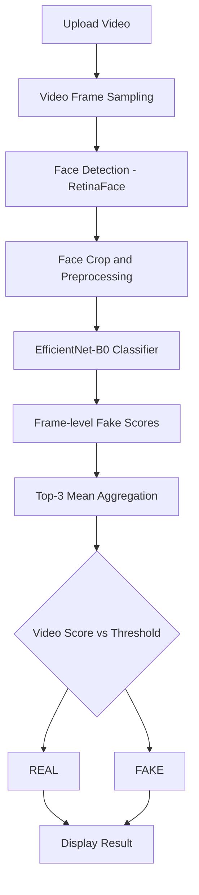

# DeepfakeShield
### Deep Learning-Based Video Deepfake Detection

DeepfakeShield is a video analysis application that uses a fine-tuned **EfficientNet-B0** model to estimate whether a video is REAL or FAKE. It samples frames from an uploaded video, detects and crops faces, evaluates the face images, and combines frame-level scores into a video-level prediction.

> **Research prototype:** DeepfakeShield is intended for academic experimentation and demonstration. Its output is a model prediction, not proof that a video is authentic or manipulated.

---

## Table of Contents
- [Project Overview](#project-overview)
- [How It Works](#how-it-works)
- [Model and Dataset](#model-and-dataset)
- [Evaluation Results](#evaluation-results)
- [Technology Stack](#technology-stack)
- [Project Structure](#project-structure)
- [Getting Started](#getting-started)
- [Using the Application](#using-the-application)
- [API Reference](#api-reference)
- [Model Checkpoint](#model-checkpoint)
- [Limitations](#limitations)
- [Future Improvements](#future-improvements)
- [Acknowledgements](#acknowledgements)

---

## Project Overview

The goal of DeepfakeShield is to provide an accessible way to examine a video for visual signs associated with deepfake manipulation. The application combines a computer-vision preprocessing pipeline with a deep-learning classifier and a web interface.

### Key Features

- Upload videos in **MP4, AVI, MOV, and MKV** formats.
- Extract up to **10 uniformly sampled frames** from a video.
- Detect faces using **RetinaFace** through DeepFace.
- Select the largest valid detected face and prepare a normalized 224 × 224 face crop.
- Classify face crops using a fine-tuned **EfficientNet-B0** model.
- Aggregate frame scores using **Top-3 Mean** video-level aggregation.
- Display a REAL/FAKE prediction and the model's fake-score estimate.
- Provide a FastAPI backend and React-based frontend.

---

## How It Works



### Processing Pipeline

1. **Video upload:** The frontend sends the selected video to the FastAPI endpoint.
2. **Frame extraction:** OpenCV samples 10 frames at approximately uniform intervals.
3. **Face detection:** RetinaFace detects faces. Detections below the configured confidence threshold are discarded.
4. **Face preprocessing:** The largest valid face is selected, cropped with surrounding context, padded where necessary, resized to 224 × 224, converted to RGB, and prepared for inference.
5. **Frame classification:** EfficientNet-B0 produces a logit for each processed face crop. A sigmoid function converts it to a fake-score between 0 and 1.
6. **Video-level decision:** The three highest frame scores are averaged. The resulting score is compared with the validation-selected threshold of **0.6783**.
7. **Result:** The application returns a REAL or FAKE prediction with processing statistics.

---

## Model and Dataset

### Model

- **Architecture:** EfficientNet-B0
- **Initial weights:** ImageNet-pretrained
- **Task:** Binary classification (REAL / FAKE)
- **Input size:** 224 × 224 RGB face crops
- **Loss:** Binary Cross-Entropy with Logits
- **Optimizer:** AdamW
- **Video aggregation:** Top-3 Mean
- **Decision threshold:** 0.6783, selected using validation data

### Dataset

The model was trained and evaluated using the **FaceForensics++ (FF++) C23** dataset.

The experiment included these video categories:

| Category | Label |
|---|---|
| original | REAL |
| Deepfakes | FAKE |
| Face2Face | FAKE |
| FaceShifter | FAKE |
| FaceSwap | FAKE |
| NeuralTextures | FAKE |

The dataset was divided into training, validation, and test partitions using group-aware splitting to reduce identity/group overlap between partitions.

| Split | Videos |
|---|---:|
| Training | 4,200 |
| Validation | 900 |
| Test | 900 |
| **Total** | **6,000** |

Face extraction produced **59,989 valid face crops** from the 6,000 videos. A small number of videos had fewer than the target 10 valid face crops because some sampled frames did not yield an acceptable face detection.

**Dataset access:** FaceForensics++ is distributed by its original authors under its own access and usage conditions. Obtain it from the official source and comply with its terms. Do not commit the dataset, extracted face crops, or restricted source videos to this repository.

---

## Evaluation Results

The following are the final **video-level results on the held-out 900-video test set**, using the validation-selected Top-3 Mean aggregation and threshold.

| Metric | Test result |
|---|---:|
| Accuracy | **93.78%** |
| Precision (FAKE) | **95.42%** |
| Recall (FAKE) | **97.20%** |
| F1-score (FAKE) | **96.30%** |
| ROC-AUC | **0.9732** |

### Confusion Matrix

Rows represent actual labels and columns represent predicted labels.

| Actual \ Predicted | REAL | FAKE |
|---|---:|---:|
| REAL | 115 | 35 |
| FAKE | 21 | 729 |

These metrics describe performance on the stated dataset and experimental split. They should not be interpreted as guaranteed performance on videos from other sources or in real-world deployment.

---

## Technology Stack

| Component | Technologies |
|---|---|
| Frontend | React, Vite, Tailwind CSS |
| Backend | Python, FastAPI, Uvicorn |
| Deep learning | PyTorch, Torchvision |
| Face detection | DeepFace, RetinaFace |
| Video and image processing | OpenCV, NumPy, Pillow |
| Data handling and evaluation | Pandas, scikit-learn |
| Visualization / experimentation | Matplotlib, Seaborn, Kaggle Notebooks |

---

## Project Structure

The application is organized into a frontend, backend processing modules, and a model checkpoint.

```text
DeepfakeShield/
├── frontend/
│   ├── src/
│   │   ├── components/
│   │   │   ├── Navbar.jsx
│   │   │   ├── Hero.jsx
│   │   │   └── UploadPanel.jsx
│   │   ├── App.jsx
│   │   └── index.css
│   ├── package.json
│   └── vite.config.js
├── src/
│   ├── preprocessing/
│   │   ├── video_processor.py
│   │   └── face_processor.py
│   └── inference/
│       ├── model_loader.py
│       ├── predictor.py
│       └── video_analyzer.py
├── models/
│   └── efficientnet_b0_best.pth
├── uploads/
├── outputs/
├── main.py
└── README.md
```

The exact files in your local checkout may differ slightly as the application evolves. Keep generated uploads, extracted frames, output files, virtual environments, and large datasets out of Git.

---

## Getting Started

### Prerequisites

- Python 3.10+ (the project was developed and tested in a Python 3.13 environment; some ML dependencies may require compatible versions).
- Node.js and npm.
- Git.
- The trained model checkpoint at `models/efficientnet_b0_best.pth`.

### 1. Clone the repository

```bash
git clone https://github.com/<YOUR_GITHUB_USERNAME>/<YOUR_REPOSITORY_NAME>.git
cd <YOUR_REPOSITORY_NAME>
```

### 2. Set up the Python backend

Create and activate a virtual environment.

**Windows PowerShell**
```powershell
python -m venv venv
.\venv\Scripts\Activate.ps1
```

Install the backend dependencies. If the repository includes a `requirements.txt`, use:

```powershell
pip install -r requirements.txt
```

If no dependency file is present yet, install the packages used by the backend and then freeze a tested environment into `requirements.txt`:

```powershell
pip install fastapi uvicorn python-multipart torch torchvision opencv-python numpy pandas deepface tf-keras
```

> PyTorch installation varies by operating system and hardware. For CPU-only Windows inference, install the CPU build from the official PyTorch installation selector. The training experiment used a Kaggle Tesla T4 GPU; local inference was tested on CPU.

### 3. Set up the frontend

```powershell
cd frontend
npm install
cd ..
```

### 4. Add the trained model

Place the trained checkpoint at:

```text
models/efficientnet_b0_best.pth
```

See [Model Checkpoint](#model-checkpoint) for handling large model files.

### 5. Run the application

Open **Terminal 1** for the backend:

```powershell
uvicorn main:app --reload
```

Open **Terminal 2** for the frontend:

```powershell
cd frontend
npm run dev
```

Open the Vite URL shown in the terminal (typically `http://localhost:5173`).

The FastAPI interactive documentation is available at:

```text
http://127.0.0.1:8000/docs
```

---

## Using the Application

1. Start both the backend and frontend.
2. Open the frontend in your browser.
3. Select a supported video or drag and drop it into the upload area.
4. Start the analysis.
5. Review the prediction and processing information returned by the backend.

The backend currently reports the video name, prediction, fake-score estimate, decision threshold, number of extracted frames, number of detected faces, number of analyzed frames, and frame-level scores.

---

## API Reference

### `GET /`

Returns basic API information.

### `GET /health`

Checks whether the backend service is running.

### `POST /analyze-video`

Uploads and analyzes a video.

**Accepted formats:** MP4, AVI, MOV, MKV.

The endpoint accepts a multipart file upload and returns a JSON response containing fields such as:

```json
{
  "video_name": "example.mp4",
  "prediction": "REAL",
  "fake_probability": 0.2701,
  "threshold": 0.6783,
  "frames_extracted": 10,
  "faces_detected": 10,
  "frames_analyzed": 10,
  "frame_predictions": [
    {
      "image_path": "path/to/frame.jpg",
      "fake_probability": 0.12
    }
  ]
}
```

The values above are an illustrative response shape from a local test, not a fixed prediction for every video.

---

## Model Checkpoint

The trained checkpoint is required for inference. If it is too large for GitHub's normal file-size limits:

- Keep the checkpoint outside the Git repository and provide a download location, or
- Use Git Large File Storage (Git LFS), subject to its storage and bandwidth limits.

Do not commit private access tokens, credentials, restricted datasets, or user-uploaded videos.

---

## Limitations

- The model was evaluated on FaceForensics++ C23; performance may differ on unseen manipulation methods, platforms, compression levels, and recording conditions.
- Face detection failures, low-resolution faces, occlusion, extreme pose, and poor lighting can affect the pipeline.
- The system analyzes sampled facial frames rather than every frame in the video.
- The fake-score is a model score and is not necessarily a calibrated probability of manipulation.
- A REAL result does not prove authenticity, and a FAKE result does not establish who created or altered a video.
- The application is a research prototype and should not be used as the sole basis for legal, financial, employment, or other high-impact decisions.

---

## Future Improvements

- Evaluate on additional deepfake datasets and manipulation techniques.
- Add more robust handling for videos with no detectable faces.
- Improve explainability with frame-level visual evidence.
- Add secure upload handling, file-size limits, and automatic cleanup of temporary files.
- Package tested backend dependencies and model setup instructions.
- Expand evaluation with cross-dataset testing and calibration analysis.

---

## Acknowledgements

- The FaceForensics++ dataset authors for providing the research dataset.
- The developers and maintainers of PyTorch, Torchvision, OpenCV, FastAPI, React, Vite, DeepFace, and related open-source tools.

---

## Disclaimer

DeepfakeShield is an academic project developed for learning and research. It does not guarantee detection of all manipulated media and should not be treated as a definitive authenticity verification service.
